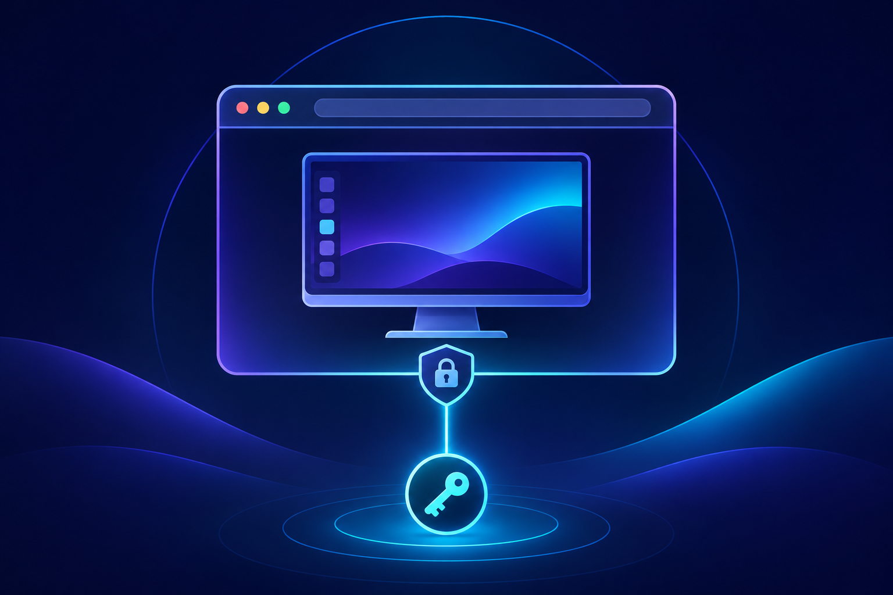
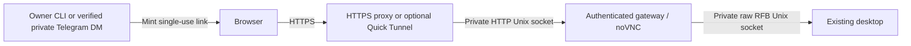

# Computer View

**Self-hosted, passwordless browser access to your existing Linux desktop.**

Computer View gives an owner access to a remote desktop through noVNC and a WebSocket-to-RFB bridge. Single-use links gate access; private Telegram delivery and a Cloudflare Quick Tunnel are optional.

[Quick start](#quick-start) · [Architecture](#architecture-and-prerequisites) · [Security](#access-model-and-limitations) · [Troubleshooting](docs/troubleshooting.md) · [Contributing](CONTRIBUTING.md)

**Linux alpha (0.1.0)** · Python 3.11+ · [MIT license](LICENSE)



> Computer View connects to an **existing** desktop and private RFB socket. It does not install a desktop, Chromium, an X server, or a VNC server.

## How it works

- **Open from a browser:** noVNC connects to your existing desktop through an authenticated gateway.
- **Share an owner-scoped link:** a short-lived, single-use capability is exchanged for a browser session. Anyone holding the link can redeem it.
- **Choose your HTTPS route:** use your own reverse proxy or the optional Cloudflare Quick Tunnel.
- **Deliver privately:** optionally send links to your verified private Telegram chat.

Human and agent input are uncoordinated; do not type simultaneously. Audio is not forwarded. This repository is not evidence of a live production deployment.

## Architecture and prerequisites



Use Linux, Python 3.11+, an existing **raw RFB Unix socket** accessible only to the configured Unix owner, and an HTTPS reverse proxy that supports WebSockets and Unix upstream sockets. An upstream requiring a separate VNC password will still prompt for it; for passwordless viewing, configure the existing RFB service to rely on its private, owner-only Unix socket rather than expose unauthenticated TCP. Never expose RFB, CDP, or the gateway directly to the Internet. Install `cloudflared` separately only if using the optional tunnel. noVNC is fetched separately, pinned and checksum-verified.

The terminal, browser, and desktop may be in different host/container namespaces. Run these commands where the package, HTTP socket, and RFB socket are reachable under the **actual configured owner's UID**. Do not assume an agent's Docker terminal is the host. See [troubleshooting](docs/troubleshooting.md).

## Quick start

Run from the checkout as the intended non-root desktop owner. No service installation or public publishing is performed by these commands.

```bash
python3 -m venv .venv
. .venv/bin/activate
python -m pip install -e .
computer-view --help

# Replace this example path with your existing private RFB socket.
computer-view init --rfb-socket "$HOME/.local/state/desktop/rfb.sock"
computer-view assets install

# Terminal A: foreground gateway; keep it running.
computer-view serve
```

In terminal B (same owner/environment), if using Cloudflare:

```bash
computer-view tunnel
```

This foreground process discovers its own temporary HTTPS origin and saves it privately. Keep it running; its hostname changes when restarted. Do not restart it merely to mint another link. For a custom executable use `computer-view tunnel --cloudflared /path/to/cloudflared`.

In terminal C:

```bash
computer-view doctor
computer-view status
computer-view --local-owner link
```

`link` prints a bearer URL in JSON: handle it as a secret. Open it only on your own device, then press **Open Computer View**. Do not paste it into public logs or groups. The confirmation page removes the token fragment from the address bar; GET previews do not consume the link.

Global options **precede** the subcommand; subcommand options follow it:

```bash
computer-view --config "$HOME/.config/computer-view/config.toml" init --rfb-socket "$HOME/.local/state/desktop/rfb.sock"
computer-view --config "$HOME/.config/computer-view/config.toml" assets install
computer-view --config "$HOME/.config/computer-view/config.toml" serve
computer-view --config "$HOME/.config/computer-view/config.toml" tunnel
computer-view --config "$HOME/.config/computer-view/config.toml" --local-owner link
computer-view --config "$HOME/.config/computer-view/config.toml" --local-owner telegram
computer-view --config "$HOME/.config/computer-view/config.toml" --local-owner revoke
computer-view --config "$HOME/.config/computer-view/config.toml" doctor
```

The explicit config `init` example is an **alternative** to the first init, not a second initialization: `init` refuses to overwrite an existing file. `--local-owner` is required for link, telegram, and revoke from an ordinary owner shell; it cannot override a supplied messaging identity. Do not fabricate or strip `HERMES_SESSION_*` variables to bypass rejection.

## Configuration and HTTPS

Defaults respect `XDG_CONFIG_HOME`, `XDG_STATE_HOME`, and `XDG_DATA_HOME`:

| Item | Default |
| --- | --- |
| Config | `~/.config/computer-view/config.toml` |
| State, database, HTTP socket | `~/.local/state/computer-view/` |
| Downloaded noVNC | `~/.local/share/computer-view/novnc` |

`init` accepts `--state-dir`, `--novnc-dir`, `--public-origin`, `--telegram-user-id`, and `--profile`. It records the current UID; do not run init with sudo and later serve as another user. Private directories use mode 0700 and new config/state files mode 0600. Review permissions after moves or restores.

For your own HTTPS proxy, initialize with `--public-origin https://desktop.example.invalid` (replace this reserved example with your origin). Forward HTTP and WebSocket traffic to the configured `http_socket`; preserve the public Host and Origin. Do not rewrite public traffic to a different hostname. TLS must be valid on the client. The gateway pins origin independently of forwarded headers. `state_dir/public-url.txt`, when present, takes precedence over `public_origin`; do not leave stale tunnel state when switching adapters. HTTPS must use an origin only: no path, credentials, query, or fragment.

## Private Telegram delivery

Create/open a private DM with your bot first. Supply **your own private Telegram user/chat ID**, never a group ID, during initialization:

```bash
computer-view init --rfb-socket "$HOME/.local/state/desktop/rfb.sock" --telegram-user-id "$OWNER_TELEGRAM_ID" --profile default
```

This is an alternative initialization example. For an existing config, stop relevant services and update only the owner-controlled TOML setting `telegram_user_id` after verifying your identity; do not delete state casually. The bot token is read from `TELEGRAM_BOT_TOKEN` by default (configurable through `telegram_token_env`), not stored in TOML. Set it through your secret manager or a protected environment file; `.env.example` is a template, **not automatically loaded** by the CLI. Do not put tokens in command arguments or shell history.

```bash
# After the token is securely exported, with serve and tunnel already running:
computer-view --local-owner telegram
# Revoke every unused link and active session, without stopping the desktop:
computer-view --local-owner revoke
```

Delivery verifies the API target and returned message are the configured private owner chat. In Hermes, inherited session UID, profile, platform, user, chat, DM type, and absence of thread routing are checked. See [the portable skill](integrations/hermes/SKILL.md); this integration is a skill, not an automatically registered slash command.

## Access model and limitations

- Unused links expire in five minutes and redeem once; anyone holding one can redeem it. Sessions have a thirty-minute absolute lifetime.
- Session cookies are Secure, HttpOnly, SameSite=Strict, and host-bound. Only digests of capabilities are stored in SQLite.
- Entry assets are public; desktop assets and `/websockify` require a valid session. Origin checks, redemption limits, and stream limits apply. Active streams are rechecked every second and on input; revocation is not a browser/desktop shutdown.
- The configured owner, root, or a compromised process with the owner's privileges is outside this authentication boundary. Access grants control of that desktop and whatever is logged into it.
- `doctor` checks local prerequisites and configured HTTPS origin syntax, not public connectivity, browser trust, a complete RFB handshake, or production readiness. Verify actual HTTPS/WSS viewing in your target browser.

## Development, operations, and release

[Contributing](CONTRIBUTING.md), [security](SECURITY.md), [troubleshooting](docs/troubleshooting.md), [third-party notices](THIRD_PARTY_NOTICES.md), and [changelog](CHANGELOG.md). Example user services are under `examples/systemd/`; review paths and adapt them rather than installing blindly. CI runs tests, lint, and package build, without contacting a live desktop or publishing.

The project's code is MIT-licensed; see [LICENSE](LICENSE). Dependencies and separately downloaded tools retain their upstream licenses; see [third-party notices](THIRD_PARTY_NOTICES.md). Review attribution before publishing.

### Optional Chromium proxy CA helper

Run inside the actual browser environment as its user. Verify the public CA file's SHA-256 independently against the trusted proxy deployment. Never supply the CA private key. `openssl` is required for checking; `certutil` (typically `libnss3-tools`) is required for import.

```bash
# Read-only check; EXPECTED_SHA256 must be obtained through a trusted source.
computer-view browser-ca --ca-file "$CA" --sha256 "$EXPECTED_SHA256" --database "$DB"
# Explicitly trust the checked public CA in the selected NSS database.
computer-view browser-ca --ca-file "$CA" --sha256 "$EXPECTED_SHA256" --database "$DB" --apply
```

The fingerprint hashes the public PEM file bytes. The helper rejects private keys, invalid fingerprints, expired/non-CA certificates and symlink database paths. Use the real database directory, not a legacy symlink. Import is idempotent and verified by exporting the stored certificate. It does not install system packages, change egress policy, disable TLS checks, restart Chromium, or guarantee Chromium uses the chosen database. Plan a controlled restart if required. Trusting a proxy CA allows that proxy to inspect HTTPS.
